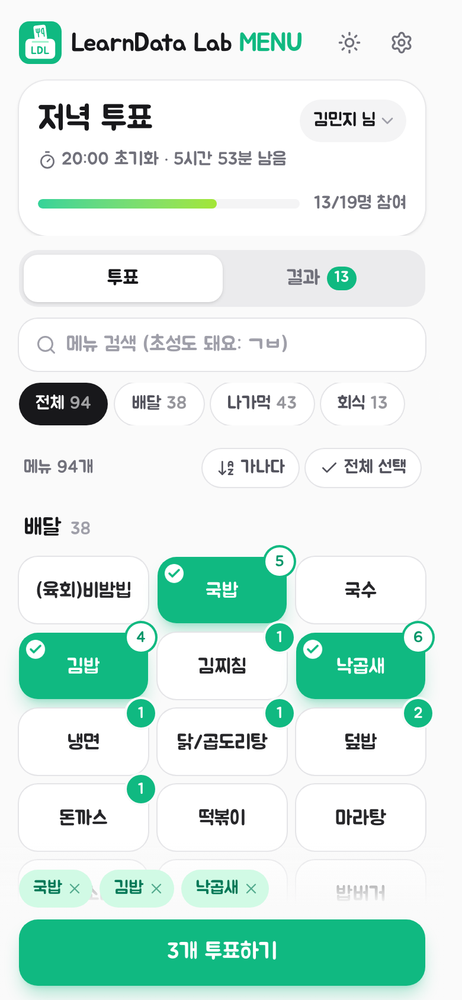
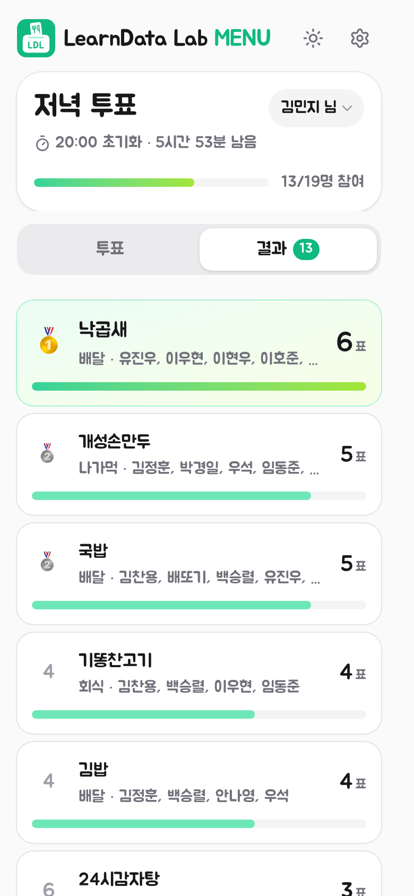
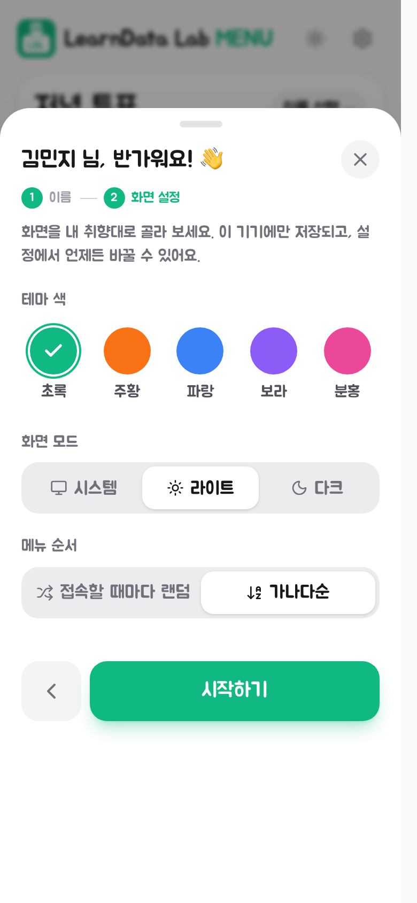
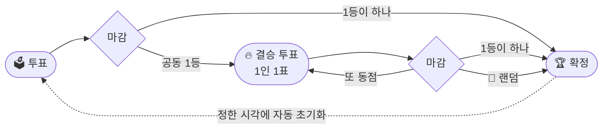
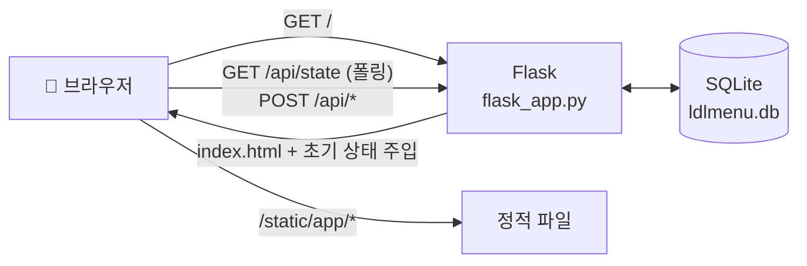

<div align="center">


# LearnData Lab MENU

**"오늘 뭐 먹지?" 30분 회의를 30초 투표로.**<br/>
SKKU LearnData Lab의 점심·저녁 메뉴 투표 웹앱

[](#-업데이트-소식)
[](https://www.python.org/)
[](https://flask.palletsprojects.com/)
[](https://www.sqlite.org/)
[](https://react.dev/)
[](https://www.typescriptlang.org/)
[](https://vite.dev/)
[](https://tailwindcss.com/)
[](https://ldlmenu.pythonanywhere.com)

### [🍽️ 지금 투표하러 가기 → ldlmenu.pythonanywhere.com](https://ldlmenu.pythonanywhere.com)

[주요 기능](#-주요-기능) · [로컬 실행](#-로컬에서-실행하기) · [배포](#-배포-pythonanywhere) · [구조](#-프로젝트-구조) · [업데이트 소식](#-업데이트-소식)

<br/>

<table>
  <tr>
    <th>🗳️ 투표</th>
    <th>🏆 결과</th>
    <th>🎨 첫 화면</th>
  </tr>
  <tr>
    <td>
      <picture>
        <source media="(prefers-color-scheme: dark)" srcset="docs/screenshots/vote-dark.png" />
        
      </picture>
    </td>
    <td>
      <picture>
        <source media="(prefers-color-scheme: dark)" srcset="docs/screenshots/result-dark.png" />
        
      </picture>
    </td>
    <td>
      <picture>
        <source media="(prefers-color-scheme: dark)" srcset="docs/screenshots/onboarding-dark.png" />
        
      </picture>
    </td>
  </tr>
</table>

<sub>GitHub를 다크 모드로 보면 스크린샷도 다크 모드로 바뀌어요 🌙</sub>

</div>

<br/>

## ✨ 주요 기능

| 기능 | 설명 |
|---|---|
| 🗳️ **한&nbsp;화면&nbsp;투표** | 먹고 싶은 메뉴를 여러 개 골라 한 번에 투표. 다시 투표하면 덮어쓰고, 언제든 취소할 수 있어요. |
| 🔍 **초성&nbsp;검색** | `ㄱㅂ`만 쳐도 김밥·국밥이 나와요. 카테고리 필터, 보이는 메뉴 전체 선택도 돼요. |
| 🔥 **마감&nbsp;&&nbsp;결승** | 마감하면 1등이 하나일 땐 바로 확정. 공동 1등이면 그 메뉴들로 **1인 1표 결승**이 열리고, 그래도 비기면 🎲 랜덤! |
| ⚡ **실시간&nbsp;반영** | 다른 사람의 투표가 새로고침 없이 반영돼요. 변화가 있으면 4초, 없으면 최대 30초 간격으로 확인하고 화면이 꺼지면 쉬어요. |
| ⏰ **회차&nbsp;자동&nbsp;초기화** | 점심·저녁처럼 회차별로 정한 시각(한국 시간)에 투표가 알아서 초기화돼요. |
| 🎨 **내&nbsp;맘대로&nbsp;화면** | 테마 색 5가지, 라이트/다크 모드, 메뉴 순서(랜덤/가나다)를 기기마다 따로 기억해요. |
| 🛠️ **설정에서&nbsp;다&nbsp;관리** | 메뉴·카테고리·사용자 추가/수정/삭제, 메뉴 묶어서 옮기기, 회차 시간 변경까지 앱 안에서. |
| 📱 **홈&nbsp;화면에&nbsp;추가** | 전용 아이콘으로 앱처럼 쓸 수 있어요 (PWA). |

### 투표는 이렇게 흘러가요



<br/>

## 🚀 로컬에서 실행하기

**준비물:** Python 3.10+ · Node.js 20.19+ (22 LTS 권장)

```bash
git clone https://github.com/Soonwook34/ldlmenu.git
cd ldlmenu

# 1) 백엔드 — http://127.0.0.1:5050
python3 -m venv .venv
.venv/bin/pip install -r requirements.txt
.venv/bin/python flask_app.py
```

여기까지만 해도 앱이 떠요. 커밋된 빌드(`static/app/`)를 Flask가 그대로 서빙하거든요.
화면(React)을 고치려면 터미널을 하나 더 열어 개발 서버를 켜세요.

```bash
# 2) 프론트엔드 개발 서버 — http://localhost:5173 (API는 5050으로 자동 프록시)
cd frontend
npm install
npm run dev
```

| 명령 | 하는 일 |
|---|---|
| `npm run dev` | 프론트엔드 개발 서버 (저장하면 바로 반영) |
| `npm run build` | 타입 체크 후 `static/app/`에 빌드 → **결과물까지 커밋** |
| `npm run typecheck` | 타입 체크만 |
| `.venv/bin/pip install pytest && .venv/bin/python -m pytest -q tests` | 백엔드 테스트 |

> [!TIP]
> 처음 실행하면 `ldlmenu.db`가 생기면서 `menu.json` · `user.json`의 메뉴와 사용자가 들어가요.
> 처음 상태로 돌아가고 싶으면 서버를 끄고 `ldlmenu.db`를 지운 뒤 다시 켜면 돼요.

<br/>

## 📦 배포 (PythonAnywhere)

서버에는 Node.js가 필요 없어요. **빌드 결과(`static/app/`)를 git에 커밋**해 두기 때문에, 서버는 `git pull`만 하면 됩니다.

### 🔁 업데이트할 때 (평소)

```bash
# ── 내 컴퓨터 ──
cd frontend && npm run build && cd ..      # 프론트엔드를 고쳤다면 반드시
git add -A && git commit -m "..." && git push
```

```bash
# ── PythonAnywhere › Consoles › Bash ──
cd ~/ldlmenu && git pull
```

마지막으로 **Web** 탭에서 초록색 **Reload** 버튼을 누르면 끝! 🎉

> [!IMPORTANT]
> `npm run build`를 빼먹고 푸시하면 서버에는 예전 화면이 그대로 나와요. `static/app/`이 변경 목록에 있는지 확인하세요.
> 파이썬 코드만 고쳤어도 **Reload**는 꼭 눌러야 반영돼요.

### 🆕 처음 한 번만 (서버 세팅)

<details>
<summary><b>펼쳐서 보기</b> — 새 PythonAnywhere 계정에 처음 올릴 때</summary>

<br/>

아래에서 `<사용자명>`은 PythonAnywhere 사용자 이름이에요.

**1. 코드 받고 가상환경 만들기** — *Consoles › Bash*

```bash
git clone https://github.com/Soonwook34/ldlmenu.git ~/ldlmenu
python3.12 -m venv ~/ldlmenu/.venv
~/ldlmenu/.venv/bin/pip install -r ~/ldlmenu/requirements.txt
```

**2. 웹앱 만들기** — *Web › Add a new web app*

- 도메인 확인 → **Manual configuration** 선택 (Flask 빠른 설정 말고) → **Python 3.12**

**3. Web 탭 설정**

| 항목 | 값 |
|---|---|
| Source code | `/home/<사용자명>/ldlmenu` |
| Working directory | `/home/<사용자명>/ldlmenu` |
| Virtualenv | `/home/<사용자명>/ldlmenu/.venv` |
| Static files | URL `/static/` → Directory `/home/<사용자명>/ldlmenu/static` |

> Static files 매핑은 선택이지만 권장해요. JS·CSS·아이콘을 Flask를 거치지 않고 바로 내보내서 더 빠르고, 무료 계정의 웹 워커 1개를 아낄 수 있어요.

**4. WSGI 파일 수정** — Web 탭의 *WSGI configuration file* 링크를 눌러 내용을 전부 아래로 바꾸기

```python
import sys

path = "/home/<사용자명>/ldlmenu"
if path not in sys.path:
    sys.path.insert(0, path)

from flask_app import app as application  # noqa
```

**5. Reload** 버튼을 누르고 `https://<사용자명>.pythonanywhere.com` 에 접속해 확인! (지금 서비스는 `ldlmenu` 계정 → [ldlmenu.pythonanywhere.com](https://ldlmenu.pythonanywhere.com))

</details>

### 🗂️ 운영 메모

- **데이터는 `ldlmenu.db` 하나에 있어요.** 프로젝트 폴더에 생기고 `.gitignore`에 들어 있어서 `git pull`해도 지워지거나 덮이지 않아요.
- **백업:** `cp ~/ldlmenu/ldlmenu.db ~/ldlmenu-backup-$(date +%F).db`
- **`menu.json` · `user.json`은 DB가 비어 있을 때 딱 한 번만** 읽어요. 그 뒤로 메뉴·사용자는 앱의 **설정**에서 바꾸세요. (파일을 고쳐도 반영되지 않아요.)
- **DB 위치를 바꾸려면** WSGI 파일의 `from flask_app import ...` 위에 `os.environ["LDLMENU_DB"] = "/원하는/경로/ldlmenu.db"`를 넣어요 (`import os` 포함).
- **무료 계정은 웹앱이 3개월마다 멈춰요.** Web 탭의 **Run until 3 months from today** 버튼을 가끔 눌러 주세요.
- 지난 회차 투표는 저장하지 않아요. 초기화 시각이 지나면 DB에서도 지워져요.

<br/>

## 🧱 프로젝트 구조

```
ldlmenu/
├── flask_app.py        # Flask 서버: / 에 앱 + 초기 상태를 내려주고, /api/* JSON API 제공
├── store.py            # SQLite 저장소 · 투표 집계 · 마감/결승 · 회차 계산
├── requirements.txt
├── menu.json           # 초기 메뉴 (DB가 비어 있을 때만 사용)
├── user.json           # 초기 사용자 (〃)
├── tests/              # pytest
├── frontend/           # React 소스
│   ├── src/
│   │   ├── App.tsx             # 한 화면 앱: 회차 카드 · 탭 · 투표/결과
│   │   ├── components/         # 투표 그리드, 하단 바, 결과, 결승, 설정 시트 …
│   │   ├── hooks.ts            # 테마 · 강조색 · 적응형 폴링
│   │   └── index.css           # Tailwind + 강조색 팔레트
│   └── vite.config.ts          # 빌드 결과를 ../static/app 으로
├── static/app/         # ⚠️ 빌드 결과 (git에 커밋함 — 서버가 그대로 서빙)
└── docs/screenshots/   # README 이미지
```



<details>
<summary><b>API 목록</b></summary>

<br/>

모든 변경 요청은 `POST` + JSON이고, 성공하면 전체 상태(`/api/state`와 같은 모양)를 돌려줘요.

| 메서드 | 경로 | 하는 일 |
|---|---|---|
| GET | `/api/state` | 전체 상태 (메뉴, 사용자, 집계, 회차, 진행 단계) |
| POST | `/api/me` | 이 기기의 사용자 지정 (쿠키) |
| POST | `/api/vote` | 내 투표 저장 (`menu_ids: []`이면 취소) |
| POST | `/api/close` | 마감 (`random: true`면 1등 후보 중 랜덤 확정) |
| POST | `/api/reopen` | 마감 취소 |
| POST | `/api/reset` | 이번 회차 투표 초기화 |
| POST | `/api/menus` · `/api/menus/update` · `/api/menus/move` · `/api/menus/delete` | 메뉴 추가 · 이름 변경 · 카테고리 이동 · 삭제 |
| POST | `/api/categories` · `/api/categories/update` · `/api/categories/delete` | 카테고리 추가 · 이름/순서 변경 · 삭제 |
| POST | `/api/users` · `/api/users/update` · `/api/users/delete` | 사용자 추가 · 이름 변경 · 삭제 |
| POST | `/api/settings/rounds` | 회차 이름과 초기화 시각 |

</details>

<br/>

## 📝 업데이트 소식

- **v2.0.4 (2026.11.20)**
    - 카카오톡 등에 링크를 공유하면 미리보기에 로고 이미지와 소개 문구가 나옵니다.
- **v2.0.3 (2026.11.20)**
    - 회차 카드의 남은 시간("5시간 57분 남음")이 두 줄로 꺾이던 문제를 고쳤습니다.
- **v2.0.2 (2026.11.20)**
    - 테마 색 주황·파랑이 적용되지 않던 문제를 고쳤습니다.
    - 이미 투표한 상태에서 '투표 완료' 버튼을 누르면 결과 화면으로 이동합니다.
    - 첫 접속 화면을 두 단계(① 이름 → ② 테마 색·화면 모드·메뉴 순서)로 나눠, 이름이 많아도 화면 설정을 놓치지 않게 했습니다.
- **v2.0.1 (2026.11.20)**
    - 제목에 LDL 투표함 로고를 넣었습니다.
    - 설정 › 설정 › 화면에서 테마 색(초록·주황·파랑·보라·분홍)을 고를 수 있습니다. 기본은 초록입니다.
    - 처음 접속한 기기에서는 이름과 함께 테마 색·화면 모드(라이트/다크)·메뉴 순서를 한 번에 정합니다.
    - 글꼴을 Jua(배민 주아체, Google Fonts)로 통일하고, 모바일에서 읽기 쉽게 글자 크기를 키웠습니다.
    - 이름 선택·설정 창을 열 때 화면이 옆으로 밀리던 문제를 고쳤습니다.
    - 설정에서 탭을 바꿀 때 창이 닫히던 오류를 고쳤습니다.
- **v2.0.0 (2026.11.20)**
    - 화면을 새로 만들었습니다. 투표·결과·설정이 모두 한 화면에서 이루어지고, 라이트/다크 모드를 지원합니다.
    - **투표 마감**: 1등이 하나면 바로 확정, 공동 1등이면 그 메뉴들로 **결승 투표**(1인 1표)가 열립니다. 결승에서는 🎲 랜덤 결정도 가능하고, 마감 취소로 되돌릴 수 있습니다.
    - 메뉴 검색(초성 검색 지원)과 카테고리 필터, 보이는 메뉴 전체 선택, 하단 고정 투표 버튼이 생겼습니다.
    - 메뉴 순서(접속할 때마다 랜덤 / 가나다순)와 테마를 기기마다 고를 수 있고, 다시 접속해도 유지됩니다.
    - 다른 사람의 투표가 자동으로 반영됩니다. (무료 티어를 고려해 변화가 있으면 4초, 없으면 최대 30초 간격으로 확인하고, 화면이 꺼져 있거나 10분간 조작이 없으면 멈춥니다.)
    - 설정 › 메뉴에서 카테고리 추가·이름 변경·순서 변경·삭제, 메뉴 여러 개를 골라 다른 카테고리로 옮기기, 메뉴·사용자 이름 수정이 가능합니다.
    - 홈 화면에 추가하면 앱처럼 쓸 수 있습니다. (전용 아이콘)
    - 회차(점심/저녁)별로 정해진 시각에 투표가 자동 초기화됩니다. 시각은 설정 › 시간에서 바꿀 수 있습니다.
    - 투표가 서버 재시작에도 사라지지 않습니다. (SQLite 저장, 최초 실행 시 `menu.json`/`user.json`을 가져옵니다.)
    - 지난 회차 투표는 저장하지 않습니다. 초기화되면 DB에서도 삭제됩니다.
    - 메뉴/사용자를 추가·삭제해도 진행 중인 투표가 유지됩니다.
    - 이름은 처음 한 번만 고르면 기기에서 계속 기억합니다. (Safari에서 이름이 풀리던 문제 해결)
    - 동점 메뉴가 순위에서 잘리지 않고, 투표가 없을 때 0표 순위가 나오지 않습니다.
    - 주소 접속만으로 투표가 초기화되거나 바뀌지 않습니다.

<details>
<summary><b>이전 버전 (v1.x, 2023)</b></summary>

- **v1.1.0 (2023.12.01)**
    - 투표자가 1명일 경우 투표 삭제 시 결과 화면이 표시되지 않는 오류를 수정했습니다.
    - 사파리에서 사용자 이름이 제대로 저장되지 않는 오류를 수정했습니다.

- **v1.0.9 (2023.11.29)**
    - 투표 삭제 시 최다 득표 수가 제대로 나타나지 않는 오류를 수정했습니다.
    - 최초 투표 이후 사용자 이름을 기억합니다.

- **v1.0.8 (2023.11.10)**
    - 투표 결과가 카테고리별로 정렬됩니다.
    - 결과 페이지에서 공동 등수를 표시합니다.
    - 투표 삭제 시 투표 총 인원이 변동되지 않는 오류를 수정했습니다. (Thanks to 우석)

- **v1.0.7 (2023.11.09)**
    - 투표 삭제가 가능합니다. (투표 주워담이)
    - 결과 페이지 상단에 투표 총 인원을 표시하였습니다.

- **v1.0.6 (2023.11.04)**
    - 재투표가 가능해졌습니다! (동일한 이름으로 투표할 시 가장 최근 투표로 업데이트됩니다.)
    - 투표 페이지 최하단에 투표 제출 버튼을 추가했습니다.

- **v1.0.5 (2023.11.03)**
    - 홈 화면에서 메뉴 항목들이 랜덤으로 정렬됩니다.
    - 파일 저장 오류를 해결하였습니다.

- **v1.0.4 (2023.10.24)**
    - 투표 페이지가 업데이트되었습니다.
    - 이제 홈화면 하단 설정에서 메뉴와 사용자 변경이 가능합니다!
    - (악용 금지 / 개발자 행동 (버그 찾기 등) 금지)

- **v1.0.3 (2023.10.23)**
    - 모바일 페이지를 바르게 지원합니다.

- **v1.0.2 (2023.10.20)**
    - 오류를 해결했습니다.

- **v1.0.1 (2023.10.20)**
    - 중대한 버그를 수정했습니다.

- **v1.0.0 (2023.10.19)**
    - ldlmenu가 출시되었습니다.
    - 이제 온라인으로 편하게 투표가 가능해졌습니다!

</details>

<br/>

<div align="center">
<sub>Made with 🍚 by 순욱 · SKKU LearnData Lab</sub>
</div>
